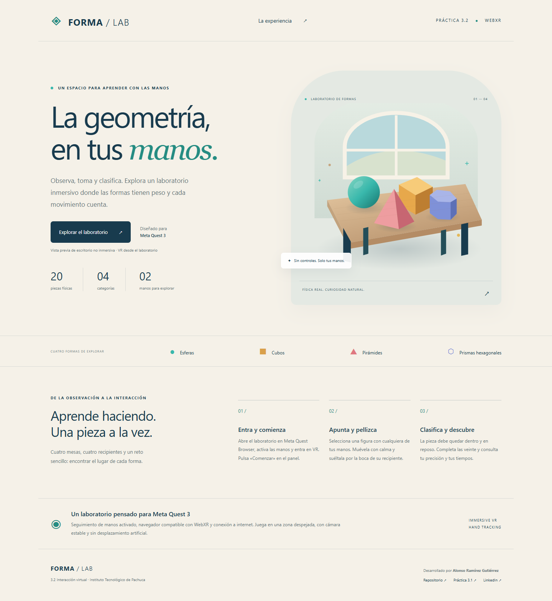
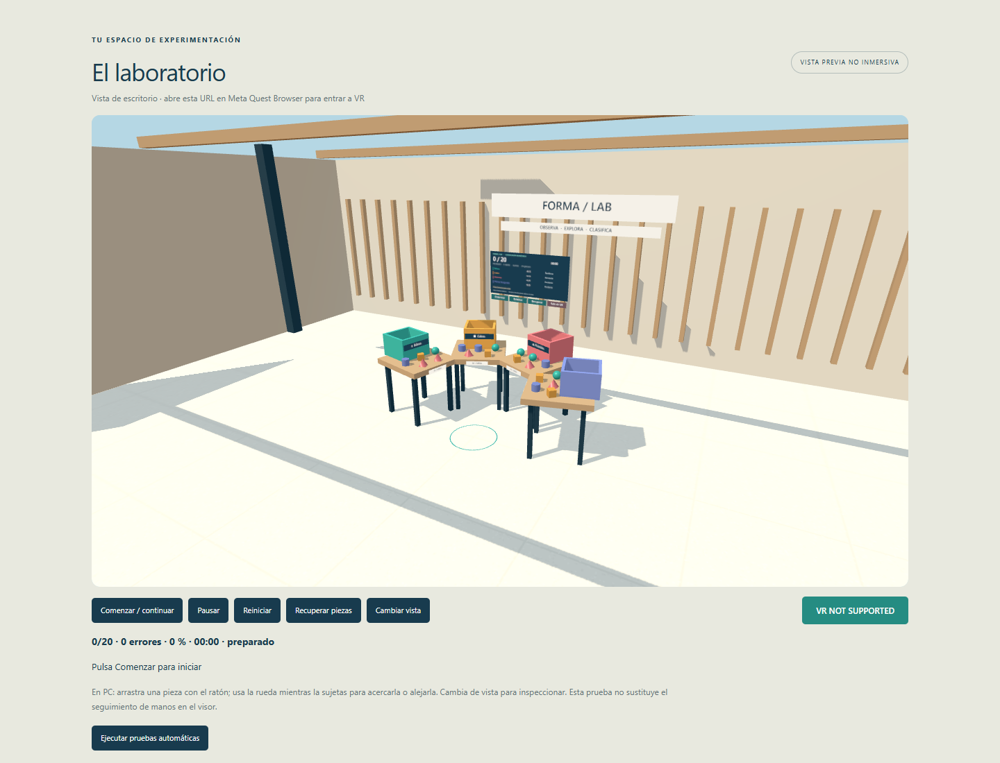

# Forma / Lab · 3.2 Interacción virtual

Laboratorio estático de clasificación geométrica para Meta Quest 3: veinte piezas físicas (cinco esferas, cubos, pirámides y prismas hexagonales), cuatro mesas y cuatro recipientes abiertos. Desarrollado por **Alonso Ramírez Gutiérrez**, Instituto Tecnológico de Pachuca.

Evolución de [práctica 3.1 Web-VR](https://alonsorgt1.github.io/Web-VR/). El original `AMBIENTE VR` quedó intacto. Se preservan VRButton, ambas manos, pinza, raycasting, transformación relativa al agarrar, liberación con velocidad reciente, reinicio, salida y créditos. El menú y el arrastre se refactorizaron para la actividad; las manos usan articulaciones procedurales para evitar descargar modelos GLB.

- [Repositorio público](https://github.com/ALONSORGT1/Laboratorio-inmersivo-de-clasificaci-n-geom-trica-con-gravedad-y-colisiones-Meta-Quest-3).
- [Abrir laboratorio en GitHub Pages](https://alonsorgt1.github.io/Laboratorio-inmersivo-de-clasificaci-n-geom-trica-con-gravedad-y-colisiones-Meta-Quest-3/): HTTPS verificado, publicación automática de GitHub completada. Evidencias en `docs/DESPLIEGUE.md`.
- [LinkedIn del autor](https://www.linkedin.com/in/alonso-ram%C3%ADrez-guti%C3%A9rrez-27074516b/).




## Ejecutar y publicar

En Meta Quest Browser puedes usar manos o mandos Touch. Al entrar en VR, mira la última línea del panel. Indica la fuente y el lado que WebXR comunica, y si hay seguimiento. Apunta el rayo a **Comenzar** y pellizca o pulsa el gatillo índice. Una vez iniciada la partida, mantén ese gesto para mover una figura y suéltalo para dejarla caer.

Si aparece **Sin entradas XR**, el navegador todavía no comunica una mano o mando con puntero. Si aparece **sin seguimiento** junto a un lado, la fuente está conectada y falta una pose válida. La aplicación detecta los cambios de fuente dentro de la misma sesión. La prueba de navegador simula ambas modalidades y el cambio entre ellas. La comprobación física sigue pendiente.

Abre `index.html` con Live Server de VS Code, o ejecuta `python serve.py` y visita `http://localhost:8080`. No uses `file://`. Python solo ofrece un servidor de archivos para pruebas locales: la aplicación desplegada no necesita servidor propio, instalaciones ni compilación.

Para publicar: en el repositorio, **Settings → Pages → Deploy from a branch → main → /(root) → Save**. El contenido ya está preparado en raíz, con `.nojekyll` y rutas relativas. La configuración final y la comprobación pública se registran en `docs/DESPLIEGUE.md`.

En Quest 3: activa seguimiento de manos, abre la URL HTTPS publicada en Meta Quest Browser, pulsa **Explorar el laboratorio**, después **ENTER VR**, permite el acceso XR solicitado por el navegador y pulsa **Comenzar** dentro del panel. Apunta y pellizca una pieza; mueve la mano suavemente hasta el recipiente correcto y suelta por su boca. Se necesita internet para las dependencias CDN.

En PC hay arrastre con ratón y rueda para cambiar la profundidad del objeto sujeto. **Cambiar vista** alterna entre panorama y posición del usuario. Es una inspección no inmersiva; no acredita seguimiento de manos ni rendimiento XR.

## Tecnologías y licencias

| Dependencia | Versión | Uso |
|---|---|---|
| Three.js | 0.187.0 | Render WebGL, VRButton, WebXR y manos |
| cannon-es | 0.20.0 | Cuerpos rígidos, solver, contactos y gravedad |
| Bootstrap | 5.3.3 | Solo interfaz web; nunca el HUD del visor |

El import map usa jsDelivr con versiones fijas. Los tres endpoints se comprobaron con HTTP 200. Three y cannon-es son MIT; Bootstrap es MIT. `libs/` conserva copias de Three y cannon-es de 3.1 con sus licencias como referencia local; el import map de producción usa CDN como exige la práctica. No se usa Node.js, npm, bundler, backend ni base de datos para ejecutar o publicar. El script opcional de QA usa Python Playwright; no es una dependencia del sitio.

Ilustración, favicon, materiales y señalética originales del proyecto. Texturas de suelo procedurales y sonidos sintetizados con Web Audio: no requieren recursos externos adicionales ni atribuciones de bancos de imágenes. La tipografía usa fuentes del sistema.

Referencias consultadas: [Three.js WebXR](https://threejs.org/examples/?q=vr#webxr_vr_handinput_pointerdrag), [Meta WebXR Hands](https://developers.meta.com/vr/documentation/web/webxr-hands/), [cannon-es](https://pmndrs.github.io/cannon-es/).

## Organización

```text
index.html             portada Bootstrap e import map
css/style.css          diseño responsivo
assets/                ilustración vectorial y favicon originales
js/config.js           categorías, escala, estaciones y umbrales
js/landing.js          carga del laboratorio bajo demanda
js/main.js             escena, ciclo físico, sesión, pausa y recuperación
js/environment.js      pabellón, mesas, recipientes y señalética
js/physics.js          mundo, cuerpos, convexos y distribución
js/interaction.js      pinza/rayos, arrastre físico y liberación
js/game.js             estados, intentos, reglas y métricas
js/hud.js              panel 3D nativo, sin HTML dentro del visor
js/audio.js            sonidos originales de feedback
tests/suite.js         pruebas cargables en navegador
tests/headless.py      QA opcional de escritorio sin interfaz
docs/                  plan, matriz, conclusiones, evidencias y despliegue
libs/                  dependencias heredadas con licencias
serve.py               servidor local heredado, opcional
```

## Distribución y física

Escala en metros. Usuario estable en `(0,0,0)`, sin locomoción artificial ni cambios forzados de cámara en VR. Las estaciones están a 1,30 m del origen en ángulos -75°, -25°, 25° y 75°. Las piezas ocupan la mitad próxima de cada mesa; los recipientes están detrás. Se usa selección a distancia y offset relativo de 3.1: las piezas lejanas pueden desplazarse mediante el movimiento de la mano sin caminar. Alcance y comodidad deben comprobarse en el visor.

Mesas a 0,82 m, superficie de 0,76 × 0,82 m. Botes con interior de 0,38 × 0,38 m, fondo a 0,85 m y boca a 1,13 m; cada uno tiene cinco cajas estáticas: base y cuatro paredes de 3,5 cm, sin techo. Piezas de aproximadamente 9–11 cm, masa 0,14 kg. Suelo, patas, paredes, zócalos y vigas visibles tienen colisionadores.

Gravedad -9,81 m/s²; fricción 0,55; restitución 0,16; 24 iteraciones del solver y SAPBroadphase. Paso fijo 1/60 s con dos micropasos 1/120 s, acumulador y delta físico limitado a 50 ms. La velocidad de agarre se limita a 1,8 m/s y la de liberación a 2,4 m/s; giro máximo de agarre 6 rad/s. Reduce el riesgo de atravesar paredes delgadas, sin afirmar detección continua de colisión: cannon-es usa contactos discretos.

Esfera y caja exactas. Pirámide de base cuadrada: cinco vértices y cinco caras convexas; prisma hexagonal: doce vértices y ocho caras. Los convexos corresponden a sus mallas y no se triangulan las caras planas para el solver. Se comparten geometrías visuales, pero cada cuerpo posee su propio colisionador y cachés físicas.

El agarre usa la aproximación dinámica controlada por velocidades de 3.1, equivalente a un objetivo cinemático con colisiones: el cuerpo conserva masa y responde a superficies estáticas. No se pone el cuerpo en tipo KINEMATIC, porque Cannon omite contactos entre cinemáticos y estáticos. Las mallas se sincronizan desde los cuerpos; nunca se mueven por separado para aparentar física. Al soltar se promedian 90 ms de velocidades lineales y angulares recientes. La pérdida de tracking o sesión libera sin lanzar. No hay snap al bote.

La distribución reserva cinco espacios separados en cada mesa con jitter y orientación aleatoria en Y. Cada mesa tiene al menos una pieza de cada categoría y una extra; las cuatro extras son distintas. El soporte inferior de cada forma se calcula antes de colocarla a 1 mm sobre la superficie. Reiniciar reutiliza los veinte cuerpos y las texturas; no añade cuerpos ni eventos por reinicio.

Para cambiar categorías, edita nombres, colores e identificadores en `config.js` y sus cuatro pares de geometría/colisionador en `physics.js`. Mantén cinco ejemplares por categoría y las medidas compatibles con las mesas y botes.

## Reglas y métricas

Cada pieza tiene una fuente de verdad: `id`, `categoria`, `mesaOrigen`, `malla`, `cuerpoFisico`, `estado`, `holder`, eventos de intento y recipiente. Estados: disponible, sujeto, liberado, estabilizándose, clasificado, error y recuperable.

Un intento empieza al soltar. Para confirmarlo se exige paso por encima de la boca, forma completa dentro del interior, contacto físico de apoyo y reposo durante **0,8 s**, con velocidad lineal <0,065 m/s y angular <0,35 rad/s. Se comprueban los vértices del colisionador en coordenadas del bote; para esferas, centro y radio. El contacto con paredes interiores se permite con tolerancia de 2 mm del solver; la parte superior debe estar bajo el borde. Un cuerpo dormido conserva evidencia de contacto de soporte, porque Cannon deja de generar contactos nuevos entre cuerpos dormidos y estáticos.

Cada intento tiene un indicador `confirmed`: no puede sumar de nuevo por contactos repetidos. Un acierto bloquea el agarre y conserva la pieza física visible. Un error confirma un solo intento, ofrece feedback distinto y permite retirar físicamente la pieza y volver a soltarla, o usar **Recuperar**. Recuperar devuelve únicamente piezas caídas o erróneas a espacios libres de una mesa; no modifica aciertos ni errores. Si no hay espacio no crea una superposición. No clasifica automáticamente.

- Total: 0/20 y cuatro contadores 0/5.
- Intentos confirmados = aciertos + errores.
- Precisión = aciertos / intentos confirmados × 100; sin intentos, 0 %.
- Cada tiempo de bote se mide desde **Comenzar** hasta la quinta validación de esa categoría.
- La partida termina exactamente a 20/20 y el cronómetro queda detenido.
- La carga web no inicia el reloj. Comenzar también reanuda una partida pausada.

El reloj usa tiempo monotónico real mientras la partida está activa, separado del delta físico limitado. Salir de VR, perder foco/visibilidad o reiniciar la referencia XR libera piezas y pausa la partida. La pausa congela simulación y reloj. Volver a entrar no reanuda automáticamente: pulsa Comenzar. Los resultados se conservan durante esa página; recargar no guarda la partida.

## Verificación y limitaciones

Consulta [matriz de veinte requisitos](docs/VALIDACION.md) y [resultados del navegador](docs/evidencias/pruebas.txt). Pruebas reproducibles: abre `/?test=1`, entra al laboratorio y pulsa **Ejecutar pruebas automáticas**. La prueba deposita cuerpos únicamente en ese modo, espera su caída física y verifica errores, veinte aciertos, estabilidad y reinicio; deja una nueva partida preparada. No se ejecuta en partidas normales.

Para repetir capturas y revisión de Console/Network en Windows: `python -m pip install playwright` y `python tests/headless.py`, con el servidor local activo. Usa Edge instalado y un perfil de pruebas aislado. No controla la sesión personal ni autentica GitHub.

**NO PROBADO EN VISOR:** ambas manos reales, gestos, lectura del panel, ergonomía, audio audible en Quest, salida/reentrada y frecuencia de render. La prueba de ratón/cuerpos físicos no equivale a una prueba WebXR. El solver no garantiza evitar penetraciones ante cualquier movimiento extremo; hay límites de velocidad y recuperación, pendientes de ajuste con visor.

## Problemas técnicos encontrados y soluciones

1. Las primeras pruebas mostraron piezas atravesando mesas: los límites AABB de cuerpos estáticos se habían calculado antes de posicionarlos y girarlos. Se marcó `aabbNeedsUpdate` después de las transformaciones. Además, los colisionadores convexos ahora usan caras poligonales completas y formas propias por cuerpo; la versión triangulada y compartida produjo apoyos inestables observados.
2. La clasificación quedaba en cero aunque una esfera estuviera quieta dentro del bote: al dormir el cuerpo, Cannon dejaba de emitir contactos. Se conserva el último soporte del recipiente y solo se reutiliza si el cuerpo sigue dormido y completamente dentro. La prueba de tres errores ya detectó y verificó esta corrección. Se reemplazó además la AABB global por vértices locales al recipiente, pues la AABB global rechazaba depósitos válidos en botes girados.

El borrador de reflexión académica está en [docs/CONCLUSIONES.md](docs/CONCLUSIONES.md). Las pruebas personales en Quest y las métricas de una partida del alumno deben añadirse después de realizarlas.
