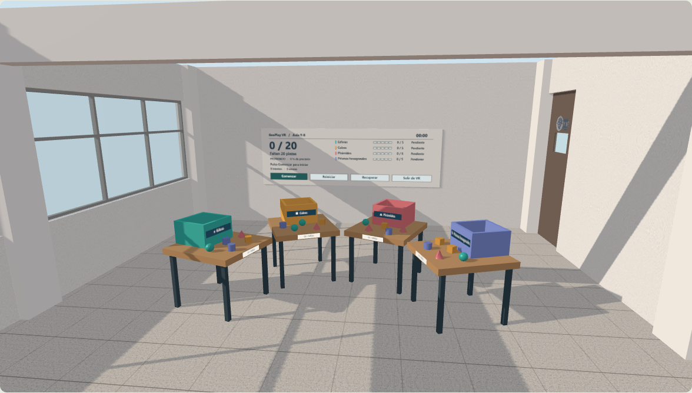

# GeoPlay VR · Aula Y-8

Clasifica veinte figuras en un salón virtual del Instituto Tecnológico de Pachuca. Cada una de las cuatro mesas tiene un recipiente para esferas, cubos, pirámides o prismas hexagonales. El pizarrón muestra el avance por categoría, los intentos, la precisión y el tiempo de la partida.

**[Jugar en GitHub Pages](https://alonsorgt1.github.io/GeoPlay-VR/)** · [Repositorio de GeoPlay VR](https://github.com/ALONSORGT1/GeoPlay-VR)



## Cómo jugar

1. Abre el juego y selecciona **Explorar el laboratorio**. En Meta Quest Browser, entra en VR y apunta a **Comenzar** en el pizarrón.
2. Apunta a una pieza. Aprieta el gatillo del mando o junta el pulgar y el índice para agarrarla. En un lanzamiento libre, la pieza hereda el movimiento y el giro de la mano. Al depositarla en un recipiente, conserva la velocidad que permiten el fondo, los bordes y las figuras que ya están dentro.
3. Deposita la figura por la abertura del recipiente correspondiente. El juego confirma el intento cuando la pieza queda completamente dentro, apoyada y estable durante 0,8 segundos. Cada categoría se completa con cinco aciertos.
4. Usa **Recuperar** para devolver piezas caídas o incorrectas a una mesa. **Reiniciar** mezcla las veinte piezas y restablece el marcador.

En escritorio, arrastra con el ratón y usa la rueda para cambiar la profundidad de la pieza. **Cambiar vista** alterna entre el panorama del salón y la perspectiva frontal del jugador.

## El salón

El modelo de SketchUp se importó a escala 1:1. La planta mide 7,50 × 8,60 m por fuera y 7,10 × 8,20 m entre las caras interiores de los muros. Los muros tienen 3,30 m de altura y la trabe central deja 2,80 m libres. En WebXR, la altura de los ojos y los movimientos proceden del visor.

Las paredes y el terrazo usan muestras de las fotografías del aula. Los ventanales llevan perfiles grises y la puerta reproduce el tono café de la referencia. La placa sobre su ventana conserva el escudo del ITP y la inscripción Y-8 de la fotografía original.

## Ejecución local y pruebas

Ejecuta `python serve.py` en la raíz y abre [la versión local](http://localhost:8080/). El proyecto usa módulos de Three.js y cannon-es cargados desde CDN. Para entrar en realidad virtual desde el visor, abre la versión HTTPS de GitHub Pages.

La simulación aplica gravedad de 9,81 m/s², colisionadores derivados del salón y subpasos adaptados a la velocidad de las piezas. La suite del navegador comprueba, entre otras cosas, la colocación del marcador sobre el pizarrón, la selección de sus botones, los lanzamientos, la recuperación y una partida completa. Abre el modo de pruebas y pulsa **Ejecutar pruebas automáticas**. [Pruebas en GitHub Pages](https://alonsorgt1.github.io/GeoPlay-VR/?test=1) · [Resultados en navegador](docs/evidencias/salon-pruebas.txt)

El salón listo para el navegador está en `assets/salon.glb`. Para regenerarlo y extraer la placa, instala NumPy y Pillow y ejecuta `python tools/convert_salon.py ruta/salon.dae assets/salon.glb ruta/fotografias`. El DAE requiere sus texturas de SketchUp junto al archivo. La carpeta de fotografías debe contener `pared.jpg`, `pared2.jpg`, `piso.jpg` y `puerta.jpg`.

## Práctica 3.3 · Sincronización con el servidor

En la rama `practica-3-3`, el aula registra cada intento en MySQL/RDS a través del backend (Vercel → EC2/FastAPI). El modelo de SketchUp, las mesas, los recipientes, la física, la pinza, el seguimiento de manos y el HUD **no cambian**.

- **Códigos**: `ESF-01…05`, `CUB-01…05`, `PIR-01…05` y `HEX-01…05` (`item.codigo`). Los contenedores son 1 = esferas, 2 = cubos, 3 = pirámides y 4 = prismas hexagonales (`CATEGORIES[].contenedor`).
- **Comenzar** hace `POST /intentos`. El id y el token se guardan **solo en memoria**: no van a localStorage, cookies ni URL.
- Cuando una pieza se **estabiliza dentro de un recipiente después de soltarla**, se envía una sola clasificación `{codigo, id_contenedor, clave_evento}` con `crypto.randomUUID()`. Cada reintento usa el mismo UUID. No se envían frames ni posiciones de manos.
- El **servidor decide** acierto o error. Mientras tanto la pieza queda en amarillo (`sincronizando`) y no se puede agarrar. El marcador del pizarrón y de la página solo cambia con datos confirmados: el evento y luego el resumen `GET /dashboard`.
- **Cola serial** con reintentos de espera creciente (1 s, 2 s… hasta 30 s, con jitter). El HUD muestra "confirmando", "error de sincronización · reintento en N s" o "sesión perdida".
- Con **20/20 confirmados** se llama a `PUT /finalizar`. **Reiniciar** queda bloqueado mientras haya pendientes; si el intento sigue activo, hace `PUT /cancelar`. Al cerrar la pestaña se cancela en modo *best effort* (`keepalive`).
- Si el servidor responde 401, 403 o 404, se avisa de que **la sesión se perdió**, se pausa la partida y se pide Reiniciar.

`js/config.js` → `API_CONFIG`. En `localhost`/`127.0.0.1` se usa `http://127.0.0.1:8000/api`. En otro host se usa `https://PROYECTO.vercel.app/api`, que debes **sustituir**. `?api=prod` fuerza producción y `?api=off` juega sin servidor.

### Pruebas 3.3
- Cola de sincronización (Node ≥ 18):

```powershell
node --test tests/api.test.mjs
```

- Extremo a extremo con física real, que requiere el backend local: abre `http://127.0.0.1:5501/?synctest=1&autorun=1` (o el puerto de tu Live Server).
- Regresión 3.2: `?test=1&autorun=1`, que puntúa localmente sin servidor.
- Resultados: [docs/evidencias/sincronizacion-3.3.txt](docs/evidencias/sincronizacion-3.3.txt).

El origen local del aula (p. ej. `http://127.0.0.1:5501`) debe estar en `ALLOWED_ORIGINS` del backend. Para GitHub Pages, el origen es `https://alonsorgt1.github.io`.

**Autor:** Alonso Ramírez Gutiérrez · Instituto Tecnológico de Pachuca.
